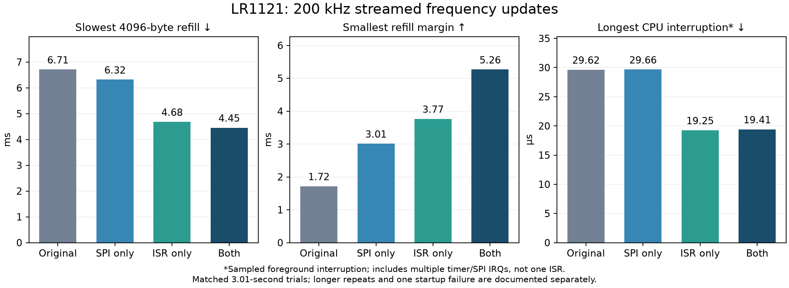

# 200 kHz TX playback measurements

Measured 2026-10-23 on LR1121 Core1121-HF, transceiver 1.3, RP2040 and Flipper Zero.
Carrier 868.350 MHz; requested power −9 dBm; physical SPI 15.625 MHz. Values below
are observed results, not guaranteed limits. These original measurements used the fixed-center optimized payload
`e1b4ab9bf01889eca1f50f64c8505821b7656aada740c2ad11dc05df114bd294`.
The variable-center player tested below is a later revision and adds one RAM read per update. The packaged host CLI was
refactored from the experiment harness; see [TX reproduction](tx.md).

| Short case, 602112 updates | Maximum 4096-byte refill | Minimum refill margin | Maximum complete CPU interruption |
| --- | ---: | ---: | ---: |
| Original ISR, 100/500 µs guard/poll | 6.710 ms | 1.715 ms | 29.625 µs, 6 timer IRQs |
| Original ISR, 2/100 µs | 6.319 ms | 3.010 ms | 29.656 µs, 6 IRQs |
| Optimized ISR, 100/500 µs | 4.682 ms | 3.765 ms | 19.250 µs, 4 IRQs |
| Optimized ISR, 2/100 µs | 4.454 ms | 5.265 ms | 19.406 µs, 4 IRQs |

Combined: 3.07× minimum refill margin and 33.6% shorter worst bank refill. A bank
holds 2048 updates, or 10.24 ms. CPU interruption includes timer and native SPI
work and bus stalls; it is not the duration of one ISR. Fast cases used small
bank-specific DC offsets; all cases verified the full checksum and retained
source/readback samples. Scheduling and sparse observation can affect maxima.

| Long repeat, 3002368 updates | Minimum margin | Maximum refill | Minimum queued banks |
| --- | ---: | ---: | ---: |
| No host pause | 5.170 ms | 4.706 ms | 7 |
| 40 ms pause | 5.000 ms | 4.664 ms | 4 |
| Repeated 40 ms pause | 5.030 ms | 4.727 ms | 4 |

All three completed with matching checksums, no player underruns and no USB-starved
polls. Flipper's fast-clock, FOC-disabled pulse recorder reported no dropped events.
The nominal 1513.672 Hz tone had a corrected pulse-pair median 1510.574 Hz; all pairs
in trimmed active windows passed a broad ±20% tone check. This verifies continuity,
not audio fidelity or spectral purity. The recorder cannot establish an emission
mask. Long repeats used Pico revision 2, adding watchdog breadcrumbs; the ARC player
was unchanged.

## Timing caveats

Preloaded cases eliminate SPI during playback. Sparse ISR brackets fell from
133–136 to 122–125 cycles, but omit entry and the final return tail. The complete
observer caught 146 cycles in the optimized preloaded case versus 128 in the
baseline; the baseline missed its slower logging branch. Those maxima cannot be
used to compare ordinary ISR cost. Nominal ARC clock is 32 MHz.

Streamed cases retained late entries up to 102 cycles (3.188 µs) and pending timer
flags. Mean rate against the nominal 32768 Hz RTC was about 199974 updates/s in
baseline and optimized runs, including preloaded playback. Calibration and isolated
coalesced expiries remain possible explanations; checksums do not prove uniform
5 µs timing. The eight-NOP observer uses consistent software IRQ epochs to unwrap
Timer0 phases, rejects ambiguous snapshots and subtracts its 13-cycle baseline.
Its maxima are sampled observations, not bounds.

## Failure accounting

Eleven cases were attempted, ten passed: 13,221,888 verified updates, including
one timer-only standby case. One earlier long attempt lost USB about 5.34 s after
arming; recovery showed a Pico guard-related watchdog reboot. Flipper never saw
the test carrier. The old host cleanup also raised on the lost USB connection and
omitted its final result. That trial is explicitly retained as failed in the
[machine-readable summary](measurements/tx-200k.json).

Pico revision 2 added retained phase/block/index breadcrumbs. Host cleanup now saves
results before reset and retains cleanup errors. Three later long passes do not
prove the startup cause was fixed. Both hardware TX deadlines remained enabled.
Every campaign recovered automatically, restored ordinary Pico 1.0.8 and the SDR
extension, and left LR1121 firmware 1.3 in standby with no error flags; the Flipper
was idle. No bootloader was replaced.

The repository includes aggregate results and the comparison figure, not device
identifiers, raw USB logs/captures or generated vendor-containing firmware images.

## Packaged implementation validation

The self-contained repository CLI and vector installer were subsequently exercised
on the same hardware: timer-only standby, preloaded RF playback and tagged queued
RF playback, each 602112 updates at 200 kHz. All three completed with matching
checksums and sparse source/readback samples. Vector readback and bootloader identity
checks passed. This check used no Flipper capture and adds no spectral-purity claim.
The ordinary receiver extension and Pico 1.0.8 were restored afterward.

At that packaging checkpoint both Pico profiles and ARC extensions built; the
fixed-center ARC hash was unchanged. This predates the variable-center revision.
Native receiver/TX tests and 34 Python tests pass, including incomplete binary-session
cleanup, disk-full cleanup and vector-manifest rejection. See the sanitized
[packaging validation summary](measurements/tx-packaging-validation.json).

## Variable center and PA profiles

The variable-center player (`1cfa582cfb01d06ac333e7c4170561319620059990201b1577b4b60c2af3e008`),
Pico `1.0.8-txopt3` and host CLI passed six subsequent 200 kHz cases, each 602112
updates: HP at 868.35 MHz/−9 and 0 dBm, LP at 868.35 MHz/−17 dBm, HP at 433.92 MHz/−9 dBm,
and HF at 2440 MHz/−18 dBm, plus timer-only standby at 1200 MHz. Every case completed
with matching checksum/source/readback, no USB-starved polls, no radio error flags
and an unexpired Pico guard. Minimum refill margin was 5.075 ms; the slowest bank
write was 4.668 ms. The added per-update center-word read still leaves useful
headroom at 200 kHz.

These checks verify configuration acceptance, PLL register values and the playback
data path. No external RF capture or calibrated output-power measurement was made
in this campaign; they do not establish usable out-of-band antenna output, actual
PA power, or spectral purity. The 1200 MHz case did not start native TX.
Both native and Pico timeouts were retained; ordinary receive firmware was restored.
See the [sanitized configuration and timing results](measurements/tx-controls-validation.json).

## 250 kHz follow-up

The later `1.0.8-txopt4` / ABI `0x46535433` build adds a 128-clock period. Three
12.009-second streams passed with no buffer underruns and a minimum 1.916 ms
refill margin. Timing controls show additional delay under SPI load, so correct
waveform delivery must not be read as uniform 4 µs spacing. See the complete
[250 kHz comparison and reproduction steps](tx-250k.md).

## External modulation controls

ABI `0x46535434` adds a per-session offset shift and accepts every timer period
from 128 to 1600 clocks. The new six-case validation includes non-preset rates,
wide signed offsets in standby and a ±75 kHz encoded waveform at 250 kHz. See
[controls, compatibility and measurements](tx-controls.md).
