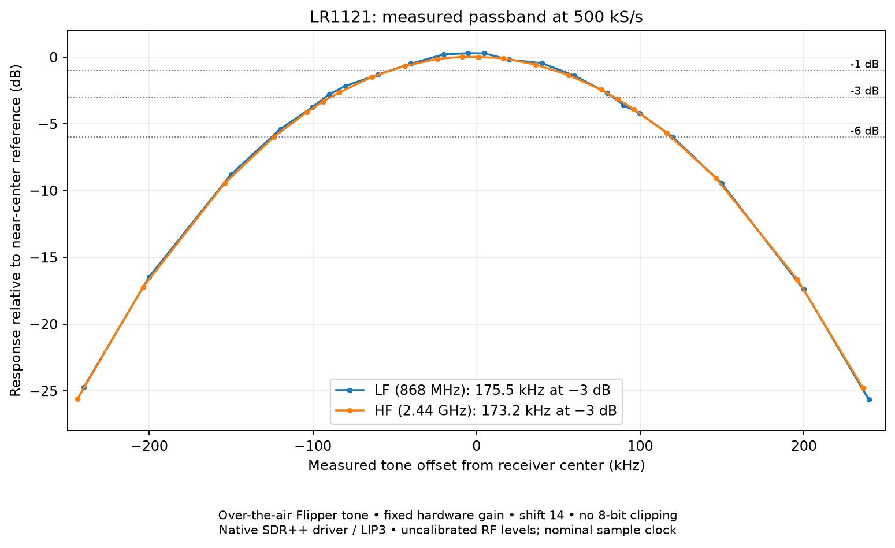

# Validation and measured bandwidth

Baseline: 2026-10-22, macOS ARM64, original Pico, Waveshare Core1121-XF **HF board
variant**, bridge 1.0.7, source 1.4.0, LR1121 app 1.3 + FIFO1. Two antennas were
connected; a Flipper supplied over-the-air reference tones. These are observed
results on one setup, not calibrated receiver specifications.

## Repository packaging checks

The separated repository rebuilt the unbound and bound Pico firmware, native
SDR++ source and macOS app. The ARC binary matched the tested 1,828-byte payload
hash. The packaged forge tool reproduced the installed encrypted image on the
same module, and its self-test regenerated the local binding without reflashing.
A fresh native 10-second run accepted 40,025 banks (5,003,125 samples), with a
zero loss marker. These checks used the existing installed radio/Pico firmware;
packaging did not reflash either device.

## Results

- 30 s native 500 kS/s run: 15,003,000 samples, no CRC/sequence/reported loss.
- Approximately 147 s SDR++ run: 73.481 million samples; no reported loss;
  DSP queue peak 32 of 256.
- 24 hardware configurations exercised all rates on LF/HF, retuning, both filters
  where supported, hardware AGC/boost, and shifts 0/8/15/16.
- Offline frame tests cover signed conversion, whitening vector, malformed
  frames, CRC rejection, scaling, terminal counts and sequence wrap. Configuration
  reuse tests include 2,210 checks; waterfall bounds tests cover the crash fix.
- Known RAM vectors exercised 250 components at shifts 0, 8, 11 and 16, including
  signed-23 extremes and saturation boundaries.
- Final LF/HF CW runs had no boundary residual above 0.5 sample; maximum was
  0.368 sample, without I/Q slope reversal. Earlier HF runs at shifts 13/14 had
  a few outliers up to about 1.1 samples. Their cause remains unresolved; the later
  clean runs do not establish indefinite loss-free acquisition.

## Bandwidth at 500 kS/s

| Input / RF region | Full width within 1 dB | Full −3 dB width | Full −6 dB width |
| --- | --- | --- | --- |
| LF, 868 MHz | 104.1 kHz | 175.5 kHz | 245.3 kHz |
| HF, 2.44 GHz | 99.6 kHz | 173.2 kHz | 243.0 kHz |



[Numeric curve and interpolated crossings](measurements/bandwidth.json).
The earlier 250 kS/s configuration measured about 85.7 kHz at −3 dB. The
500 kS/s mode roughly doubles that usable width, while the shoulders of the
500 kHz display span are strongly attenuated.

Method: fixed carrier, vary receiver LO; 22 offsets per input, five interspersed
near-center references. Fit a complex sinusoid plus DC to 4,000 samples after
skipping the first 500. Normalize amplitude against interpolated reference
amplitudes, then interpolate the dB crossings between measured offsets. Settings:
manual gain step 10, boost 0, wide GFSK, shift 14. No sweep point hit the int8
endpoints. Reference variation was LF 0.276 dB / HF 0.038 dB. The asymmetry includes
reference drift and normalization error. Nominal sample rate was used; the clock
was not independently calibrated.

## Reproduce continuity checks

Run `python tools/test.py`, then use the native probe as in
[operation.md](operation.md). A 30-second `500000` run with output path `-` checks
transport without writing a large capture. Record JSON and exit status; terminal
statistics include actual SPI frequency and a loss marker. Merely hearing audio
is not a continuity test.

For tone analysis:

```sh
pip install -r host/requirements-analysis.txt
python host/analyze_tone.py build/tone.cf32 --rate 500000
```

The phase calculation fits each 125-sample bank and converts inter-bank residuals
into equivalent missing/extra samples. Interpret it only for a dominant, unclipped
CW away from DC/Nyquist, with consistent phase slopes. Multipath, interference,
low SNR and quantization can also cause residuals. Positive/negative slope changes
can reveal I/Q ordering problems. CRC alone cannot detect an acquisition stall.

## Optional Flipper reference

`host/reference.py` provides `Flipper.tone(868350000)` / `tone(433920000)` and
`BluetoothFlipper.bt_tone(channel=19, power=0)`. Both use context managers, send
Ctrl+C on exit and have a four-second host watchdog. The outer context enables
debug temporarily and restores debug off. It expects debug initially disabled.
Close any active Flipper application before testing. Use a low-power, brief
reference in an appropriate RF test environment; do not leave a carrier running.

The BLE test needs stack type 1 (Full). Its expected carrier is
`2402 MHz + 2 MHz*channel − 250 kHz`; actual frequency includes oscillator offset.
Do not assume the BLE channel center is the measured tone frequency. The prior
2.44 GHz sweep selected channel 19. Do not change the Flipper firmware merely to
run the repository's offline tests.

Use the persistent `build/tests/retune_probe PORT` process to avoid full setup
inside the four-second carrier window. It accepts one JSON object per line and
returns one JSON result per line after the initial ready record. For example:

```json
{"frequency":868320000,"rate":500000,"input":1,"agc":false,"gain":10,"boostLF":0,"wide":true,"shift":14,"blocks":0}
{"frequency":868320000,"rate":500000,"input":1,"agc":false,"gain":10,"boostLF":0,"wide":true,"shift":14,"blocks":4000,"file":"build/tone.cf32"}
```

Send the first request before starting the carrier; issue the second inside its
context manager. Each block is 125 samples: 4,000 blocks are 1 s at 500 kS/s.
End the tone context, then close probe stdin to return the receiver to standby.
Repeat a short capture with the tone off. A Python coordinator can import
`host.reference` and drive the probe with `subprocess.Popen`; do not issue ASCII
bridge commands during a binary stream.

For a passband sweep, keep transmitter position/power, hardware gain, boost and
shift fixed. Sweep LO offsets −240, −200, −150, −120, −100, −90, −80, −60, −40,
−20, −5, +5, +20, +40, +60, +80, +90, +100, +120, +150, +200, +240 kHz around
the measured carrier. Insert a +10 kHz reference every five points. Use 80 blocks
per point and `fast_tone` from `host/analyze_tone.py` on samples 500:4500. Reject
clipped or low-purity fits, normalize to the references, and calculate crossings
as above. Measure actual tone offset from each fit rather than assuming exact RF
frequency. Save captures locally; the committed JSON contains only aggregate data.
